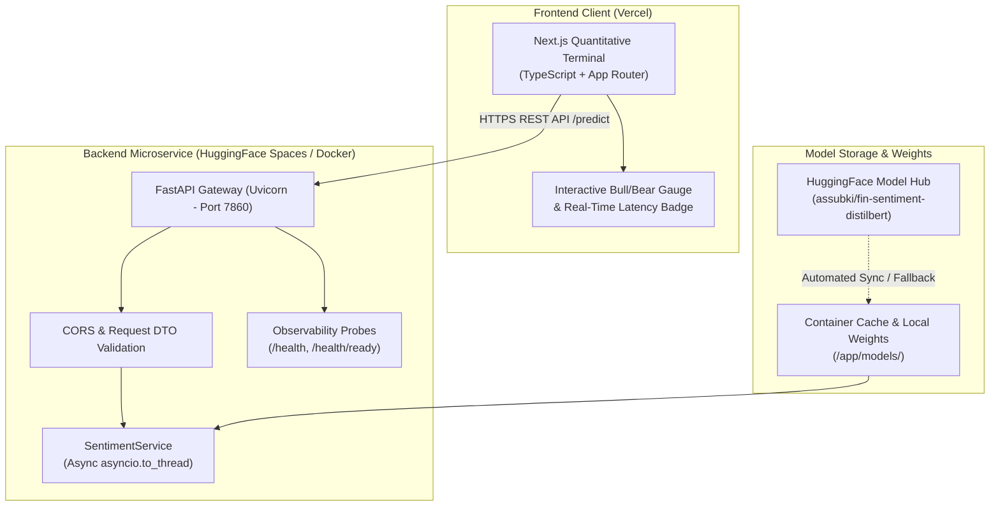

# Quant Market Sentiment Engine

[](https://github.com/subki72/quant-market-sentiment-engine/actions)
[](https://huggingface.co/spaces/assubki/Quant-Market-Sentiment-Engine)
[](https://www.python.org/downloads/)
[](https://fastapi.tiangolo.com)
[](https://pytorch.org/)
[](https://github.com/subki72/quant-market-sentiment-engine)
[](https://opensource.org/licenses/MIT)

A **production-grade Natural Language Processing (NLP) microservice** that extracts actionable market sentiment signals (**BULLISH**, **BEARISH**, **NEUTRAL**) from real-time financial headlines, tweets, and conference call transcripts.

Engineered with fine-tuned **DistilBERT**, an asynchronous **FastAPI** service layer, multi-stage **Docker** containerization, **GitHub Actions CI/CD**, and a high-performance **Next.js** quantitative terminal.

---

## System Architecture



---

## Key Highlights & Production Engineering

- **Asynchronous Non-Blocking Inference**: PyTorch CPU matrix computations run via `asyncio.to_thread`, keeping FastAPI's event loop completely unblocked under concurrent request loads.
- **Fail-Safe Model Ingestion**: Self-healing model lifecycle through FastAPI's `lifespan` manager with graceful fallback from local storage to Hugging Face Model Hub, returning clean HTTP `503 Service Unavailable` instead of unhandled runtime crashes.
- **Microservice Observability**: Built-in `/health` (liveness) and `/health/ready` (readiness) endpoints for Kubernetes and container load balancers, backed by Python structured logging.
- **Sanitized Security Layer**: Strict input payload bounds (1 - 2000 characters) with zero internal stack-trace leakage in API responses.
- **Multi-Stage Containerization**: Minimal image footprint using CPU-optimized PyTorch wheels with non-root user (`UID 1000`) for seamless Hugging Face Spaces compatibility.
- **Comprehensive Quality Gates**: 100% route test coverage, 70%+ overall code coverage, and automated GitHub Actions CI pipeline.

---

## Model Specifications & Evaluation

Fine-tuned on the `zeroshot/twitter-financial-news-sentiment` benchmark with Macro-F1 penalty for minority market regimes:

| Metric | Score | Details |
|---|---|---|
| **Base Model** | `distilbert-base-uncased` | 6 layers, 768 hidden size, ~66M parameters |
| **Accuracy** | **86.89%** | Outperforms standard non-domain general LLMs |
| **Macro F1** | **82.84%** | Balanced detection across Bearish and Bullish regimes |
| **P95 Latency** | **~15 - 25 ms** | Real-time CPU inference throughput |
| **Model Card** | [`MODEL_CARD.md`](MODEL_CARD.md) | Standard Hugging Face Model Card documentation |

---

## Quick Start

### 1. Local Environment Setup

```bash
# Clone the repository
git clone https://github.com/subki72/quant-market-sentiment-engine.git
cd quant-market-sentiment-engine

# Create and activate virtual environment
python -m venv .venv
source .venv/bin/activate  # On Windows: .venv\Scripts\activate

# Install development dependencies
pip install -r requirements-dev.txt

# Copy environment variables template
cp .env.example .env
```

### 2. Download or Sync Model Weights

To download and cache the model from Hugging Face Hub:
```bash
python scripts/download_model.py --repo-id assubki/fin-sentiment-distilbert
```
*(If the repository is not yet published, the script automatically uses a compatible public financial model fallback).*

### 3. Run FastAPI Backend

```bash
uvicorn src.app:app --reload --host 0.0.0.0 --port 8000
```
Interactive API documentation will be available at [http://localhost:8000/docs](http://localhost:8000/docs).

### 4. Run with Docker Compose

```bash
docker compose up --build
```
The FastAPI backend will start at `http://localhost:8000` and the Next.js frontend at `http://localhost:3000`.

---

## Testing & Code Quality

Execute the test suite and verify coverage threshold:
```bash
# Run pytest with terminal coverage report
pytest -v --cov=src --cov-report=term-missing

# Run Flake8 static analysis
flake8 src tests scripts
```

---

## API Reference

### 1. Classify Financial Text Sentiment
**Endpoint**: `POST /predict`

**Request Body**:
```json
{
  "text": "Tesla reports record-breaking quarterly revenue, beating analyst consensus by 18%."
}
```

**Response (HTTP 200 OK)**:
```json
{
  "text": "Tesla reports record-breaking quarterly revenue, beating analyst consensus by 18%.",
  "signal": "BULLISH",
  "confidence": 93.85,
  "probabilities": {
    "BULLISH": 93.85,
    "BEARISH": 3.10,
    "NEUTRAL": 3.05
  },
  "latency_ms": 18.42
}
```

### 2. Service Health & Readiness Probes
- `GET /health`: Returns service operational status (`{"status": "healthy", "model_loaded": true, ...}`).
- `GET /health/ready`: Returns HTTP `200 OK` when model weights are hot in memory, or HTTP `503 Service Unavailable` if loading.

---

## Cloud Deployment Guide (100% Free - No Credit Card Required)

### Deploy Backend to Hugging Face Spaces (Free Tier)
1. Navigate to [Hugging Face Spaces](https://huggingface.co/new-space).
2. Space Configuration:
   - Space name: `quant-market-sentiment-engine`
   - License: `MIT`
   - Space SDK: Select **Gradio** (Free - 2 vCPU, 16GB RAM, no credit card required).
3. Connect your repository or push via Git:
   ```bash
   git remote add space https://huggingface.co/spaces/<your-username>/quant-market-sentiment-engine
   git push space main
   ```
4. Hugging Face Spaces automatically reads `requirements.txt` and executes `app.py`.
5. The deployment provides both the interactive Gradio UI and the full FastAPI REST API (`/predict`, `/health`, `/docs`) on `https://<your-username>-quant-market-sentiment-engine.hf.space`.

### Deploy Frontend to Vercel (Free Hobby Tier)
1. Go to [Vercel](https://vercel.com/new).
2. Import your GitHub repository (`subki72/quant-market-sentiment-engine`).
3. Project Settings:
   - **Root Directory**: Click Edit and select `frontend`.
   - **Framework Preset**: Next.js (automatically detected).
4. Environment Variables:
   - Name: `NEXT_PUBLIC_API_URL`
   - Value: `https://assubki-quant-market-sentiment-engine.hf.space`
5. Click **Deploy**. Vercel will build and host the retro-futuristic chassis UI with free automatic HTTPS and global edge routing.

---

## License
This project is licensed under the MIT License - see the [LICENSE](LICENSE) file for details.
